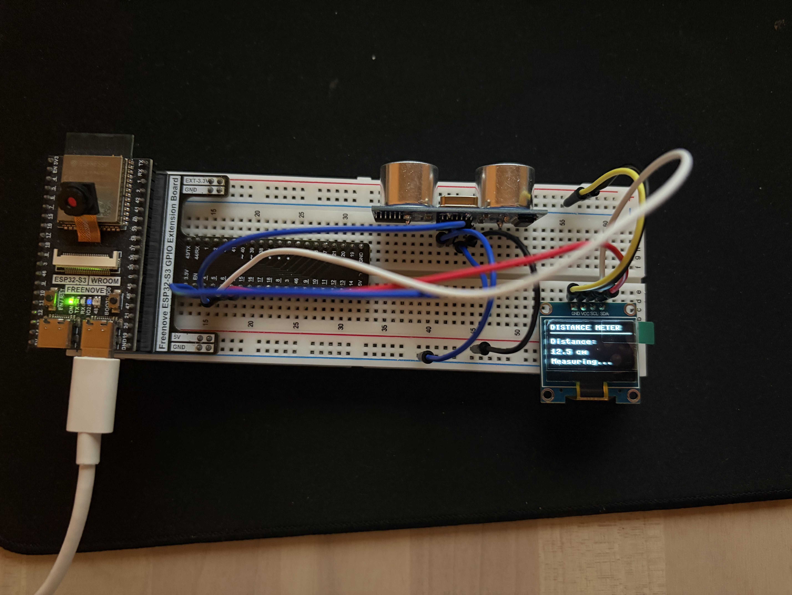

# Project 03 — Smart Distance Meter

Measure the distance to an object with an HC-SR04 ultrasonic sensor and show the live reading on a 128 × 64 SSD1306 OLED. An ESP32-S3 runs the program in MicroPython.

This project brings together digital output, pulse timing, a simple distance calculation, and an I2C display. The program takes a new measurement about five times per second. It shows **TOO CLOSE!** when an object is less than 10 cm away, and shows a message when the sensor does not receive an echo.

## What you will build

The ESP32 sends a short pulse to the ultrasonic sensor. The sensor emits an ultrasonic burst and listens for its reflection. It holds its ECHO pin high for the time the sound takes to travel to the object and back. The ESP32 measures that pulse, estimates the one-way distance, and displays the result in centimeters.

```text
ESP32-S3 ── trigger pulse ──> HC-SR04 )) sound )) object
ESP32-S3 <── echo pulse ───── HC-SR04 (( reflection ((
    │
    └── I2C ──> SSD1306 OLED shows the distance
```

## Parts and tools

### Hardware

- ESP32-S3 development board
- HC-SR04 ultrasonic distance sensor
- 128 × 64 SSD1306 OLED with I2C interface
- Breadboard and jumper wires
- One 1 kΩ resistor and one 2 kΩ resistor for an ECHO voltage divider
- USB data cable
- Computer for editing and transferring MicroPython files

### Why the two resistors matter

The common HC-SR04 is powered from 5 V and its ECHO output can also rise to 5 V. ESP32 GPIO pins are not 5 V tolerant. Use a voltage divider between ECHO and the ESP32 so the signal reaching GPIO 5 is reduced to a safe level. This guide uses 1 kΩ from ECHO to the GPIO 5 junction and 2 kΩ from that junction to GND. Do not connect a 5 V ECHO signal directly to the ESP32.

Some HC-SR04-compatible modules have different electrical specifications. Check the documentation for your exact module; if it produces a 5 V ECHO signal, use a divider or a suitable logic-level shifter.

## Wiring

These assignments match `main.py`. Check the GPIO labels on your particular ESP32-S3 board before connecting wires.

### HC-SR04 ultrasonic sensor

| HC-SR04 pin | Connection | Purpose |
| --- | --- | --- |
| VCC | ESP32-S3 5V/VIN rail | Powers the sensor at 5 V |
| GND | ESP32-S3 GND | Shared ground reference |
| TRIG | ESP32-S3 GPIO 4 | Receives the measurement-start pulse |
| ECHO | Voltage divider, then ESP32-S3 GPIO 5 | Returns a pulse whose width represents the sound travel time |

Connect the ECHO divider like this:

```text
HC-SR04 ECHO ── 1 kΩ resistor ──┬── ESP32-S3 GPIO 5
                                │
                               2 kΩ
                                │
All grounds ────────────────────┴── GND
```

The connection point between the two resistors goes to GPIO 5. The lower resistor connects that point to GND. The ESP32, sensor, and OLED must share a common ground.

### SSD1306 OLED

| OLED pin | ESP32-S3 connection | Purpose |
| --- | --- | --- |
| VCC | 3V3 | OLED power |
| GND | GND | Shared ground |
| SCL | GPIO 6 | I2C clock |
| SDA | GPIO 7 | I2C data |

The program uses I2C bus 0, 100 kHz, and the common OLED address `0x3C`. If your display stays blank, check the module label and try address `0x3D` if its documentation specifies that address. Do not connect the OLED to 5 V unless that module explicitly supports it.

## How the measurement works

The key steps in `main.py` are:

1. GPIO 4 is configured as an output for TRIG; GPIO 5 is configured as an input for ECHO.
2. The program holds TRIG low briefly, then sends a 10 microsecond high pulse. This asks the HC-SR04 to start a measurement.
3. The sensor sends an ultrasonic burst and waits for the reflected sound.
4. `time_pulse_us(echo, 1, 30000)` measures how many microseconds ECHO stays high. The 30,000 microsecond timeout prevents the program from waiting indefinitely.
5. The speed of sound is approximated as 0.0343 centimeters per microsecond. Because the pulse covers the trip to the object and back, the program divides by two:

   ```text
   distance_cm = echo_duration_us × 0.0343 ÷ 2
   ```

6. If the sensor times out or MicroPython reports an I/O error, `measure_distance()` returns `None`. The screen displays **No echo found / Check sensor** in that case.
7. Otherwise, the OLED shows the measured distance to one decimal place. If the distance is below 10 cm, it shows **TOO CLOSE!**; at 10 cm or more, it shows **Measuring...**.
8. The display refreshes every 0.2 seconds.

The displayed distance is an estimate. Readings can vary with the sensor, temperature, target shape, target angle, and surface material. Large, flat objects facing the sensor generally give more reliable echoes than soft, narrow, or angled objects.

## Project files

```text
03-smart-distance-meter/
├── README.md              This build and code guide
├── main.py                MicroPython measurement and display program
└── media/                 Photos and video of the assembled project
```

`main.py` imports `ssd1306`, the SSD1306 MicroPython driver. The repository includes that driver in Project 02 at [`../02-let-display/ssd1306.py`](../02-let-display/ssd1306.py). Copy that file to the ESP32 alongside this project's `main.py`. If you have another compatible SSD1306 driver installed on the board, you can use it instead.

## Setup and run

### 1. Install MicroPython

The ESP32-S3 must have MicroPython firmware installed. If Thonny can connect and its Shell shows a `>>>` prompt, the interpreter is ready. If not, install a firmware build intended for your exact ESP32-S3 board using Thonny's **Install or update MicroPython** workflow.

### 2. Connect the circuit

Wire the HC-SR04 and SSD1306 using the tables above. Before powering the circuit, double-check the ECHO voltage divider and the shared ground. The sensor's 5 V ECHO signal must not go directly to GPIO 5.

### 3. Copy the program files to the board

Using Thonny:

1. Connect the board over USB and select its MicroPython interpreter and serial port.
2. Open `main.py` from this project folder.
3. Choose **File → Save as… → MicroPython device** and save it on the ESP32 as `main.py`.
4. Copy `ssd1306.py` from Project 02 to the ESP32 in the same way, saving it as `ssd1306.py` at the device's top level.
5. Click **Run** in Thonny. To start this program automatically after power-up, keep the file named `main.py` on the ESP32 and reset the board.

The ESP32 should display a distance reading when an object is in front of the sensor. Move a hand or another solid object nearer and farther away to observe the reading change.

## Adjusting the program

The pin configuration is near the top of `main.py`:

```python
i2c = I2C(0, scl=Pin(6), sda=Pin(7), freq=100000)
trig = Pin(4, Pin.OUT)
echo = Pin(5, Pin.IN)
```

If you use different GPIO pins, update both the wiring and these declarations. The OLED constructor defaults to address `0x3C`; set `addr=0x3D` if your display uses `0x3D`.

To change the close warning distance, edit:

```python
if distance < 10:
```

The value is in centimeters. To change how often the screen updates, edit the final `sleep(0.2)` value; for example, `sleep(0.5)` refreshes twice per second.

## Troubleshooting

### The OLED is blank

- Check VCC, GND, SCL, and SDA wiring.
- Confirm the program's GPIO 6 and GPIO 7 match your actual I2C connections.
- Check whether the OLED address is `0x3C` or `0x3D`.
- Confirm `ssd1306.py` is on the ESP32 and can be imported by `main.py`.
- Make sure the OLED module is powered at a voltage it supports.

### The screen says “No echo found”

- Check that the sensor's VCC and GND are connected and share ground with the ESP32.
- Confirm TRIG is connected to GPIO 4 and ECHO passes through the divider to GPIO 5.
- Point both round transducers toward a solid target. Very soft, narrow, or angled objects may not return a strong echo.
- Check the sensor's pin labels; the order can vary between modules.

### The distance is unstable or clearly wrong

- Recheck the ECHO divider and all jumper connections.
- Keep the sensor still and point it squarely at a broad, flat target.
- Avoid measuring through or very close to obstacles that can reflect the sound first.
- Remember that this simple program uses a fixed speed-of-sound estimate and does not average multiple readings.

### Thonny cannot connect

- Select **MicroPython (ESP32)** and the serial port that appears when the board is plugged in.
- Close VS Code serial terminals or other programs using the same port.
- Press RESET once and reconnect. If no MicroPython `>>>` prompt appears, install or repair the board's MicroPython firmware.

## Media

The [`media/`](media/) folder contains photos and a video of the ESP32-S3, breadboard, sensor, OLED, and the running distance display.



## Possible improvements

- Average several samples to reduce jitter.
- Add a bar graph or distance bands to the OLED.
- Add an audible buzzer warning when an object is too close.
- Calibrate the displayed value against a ruler and document the error over a range of distances.
- Add a button to switch between centimeters and inches.

## Author

Dimitar Dimov — part of the ESP32 Projects Lab learning portfolio.
